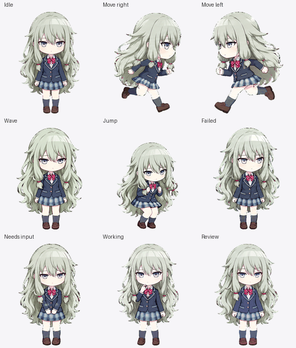

# nene-codex-pet

《Project SEKAI》草薙宁宁（Kusanagi Nene）的非官方 Codex 桌面宠物项目。

| 宠物 | 造型与画风 | 规格 |
| --- | --- | --- |
| [草薙宁宁 · 初始校服](nene-initial-uniform/README.md) | 初始神山高校校服，参考 1 星卡「爱损人的社交恐惧者」；Q 版日系插画 | v2，9 种动画、16 个注视方向 |

## 下载与安装

在 [Releases](https://github.com/scenesuki/nene-codex-pet/releases) 下载 `nene-codex-pet-v1.0.0.zip`，解压得到 `nene-initial-uniform/`。

1. 将该目录复制到 `~/.codex/pets/`；Windows 默认路径为 `%USERPROFILE%\.codex\pets\`。若设置了 `CODEX_HOME`，使用其下的 `pets/`。
2. 确保 `pets/nene-initial-uniform/pet.json` 与 `spritesheet.webp` 同时存在。
3. 打开 Codex 的设置 > Pets，刷新列表并选择「草薙宁宁 · 初始校服」；如未显示，重新启动应用。

也可从本仓库的 `nene-initial-uniform/` 复制这两个文件。ZIP 附带说明、验证记录及动画总览，其余文件不影响加载。`SHA256SUMS.txt` 用于核对下载包。

## 验证范围

最终无损 RGBA WebP 为 1536 × 2288，8 × 11 格，每格 192 × 208。已检查动画帧数、透明边缘、方向语义、循环预览及包内文件一致性，并在制作机安装目录检查文件哈希、重放实际应用的版本及图片验证算法。

**应用设置列表中的识别、选用及浮动显示尚未实测。** 本机验证依据为 `OpenAI.Codex_26.1007.2314.0` 的实际加载与渲染代码，不保证所有未来版本的界面或合同一致。详细来源和验收记录见 [本套 README](nene-initial-uniform/README.md)。

## 项目结构

每套宠物在根目录独立存放；最终导入文件位于宠物目录顶层，`preview/` 保存预览，`source/` 保存参考、提示词、原始生成结果、候选和检查记录。`scripts/` 保存共用辅助脚本；`release-assets/<tag>/` 保存本地发布附件，不提交 Git。完整约定见 [AGENTS.md](AGENTS.md)。

制作资料和旧包均保留。辅助验证脚本中涉及本机应用安装包的检查需要相应 Windows 版本及路径；预览和打包脚本使用 Python 与 Pillow。

本项目为非官方同人作品，权利说明见 [NOTICE.md](NOTICE.md)。
