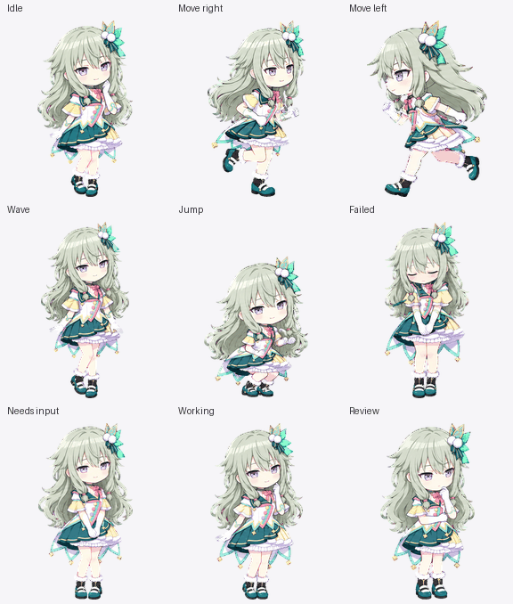

# nene_costume · Brand New Style

- 宠物 ID 与显示名称：`nene_costume`，按用户指定保留下划线。
- 角色：草薙宁宁；造型为二星卡「Brand New Style」对应的新舞台服。
- 画风：用户已确认 Q 版日系插画。
- 交付：完整 Codex v2 宠物、九种动画、十六个注视方向与预览；完成后制作包含全部三套宠物的本地 Release，暂不上传 GitHub，不安装或切换当前宠物。

## 制作进度

- [x] 核对造型、参考和目标规格。
- [x] 制作并检查角色样张：`source/references/canonical-base.png`。
- [x] 制作九种动画与十六个注视方向。
- [x] 完成图集、预览与验收。
- [x] 生成含三套宠物的本地 v1.2.0 Release。

## 参考与设计

[官方角色资料与当前舞台服立绘](https://pjsekai.sega.jp/character/unite04/nene/index.html) 为外观依据；游戏资料镜像中的卡号 738、`res015_no028`、角色 15、二星、卡名「Brand New Style」记录在 `source/references/card-738-game-data.json`，对应 [卡名索引](https://projectsekai.fandom.com/wiki/Brand_New_Style)。卡面镜像直接下载受限，使用官方当前舞台服完整立绘核对服装。官网 `card_2.png.webp` 实际为人鱼卡，已排除，不参与生成。

辨识特征：灰绿长发、紫色眼睛，白色尖角衣身配青绿肩部与裙摆、淡黄短袖、粉色领结与斜饰边、白色褶边及淡紫侧裙、白色长手套、青绿黑色短靴与白色交叉绑带、头部画面右侧的羽饰和白花。Q 版保留主要层次与不对称配饰，细线和小花作适度简化。

官方资料强调宁宁安静、毒舌但认真，喜爱游戏，擅长歌唱并憧憬舞台。宠物的拘谨招手、小幅舞台跳跃、认真思考、等待询问和审视表情为创作演绎，不宣称为原游戏动画或卡片剧情中的实际动作。

## 目标规格与来源

2026-10-13 只读复核本机 `OpenAI.Codex_26.1007.2314.0` 实际加载与渲染代码，摘要与模块 SHA-256 见 `source/references/app-contract-verification.json`。目标无损 RGBA WebP 为 1536 × 2288，8列 × 11行，每格192 × 208；`spriteVersionNumber: 2`。

0–8行为 idle、running-right、running-left、waving、jumping、failed、waiting、running、review，分别使用6、8、8、4、5、8、6、6、6帧。9–10行为顺时针16个注视方向，以向上为0°，每步22.5°。未使用动画格完全透明。

最终导入文件在本目录顶层保存为 `pet.json` 与 `spritesheet.webp`；`source/` 保存本套参考、提示词、原图、分格、组装和验收记录。应用设置识别、实际选用与浮动显示尚未验证。

## 最终文件与预览

安装入口为本目录的 [pet.json](pet.json) 与 [spritesheet.webp](spritesheet.webp)，两者需一起复制到 `~/.codex/pets/nene_costume/`；Windows 默认位置为 `%USERPROFILE%\.codex\pets\nene_costume\`。显示名称按用户指定为 `nene_costume`。本次未执行安装或切换当前宠物。

图集 SHA-256：`32b5347cfbae94b3c225f7ddc833f8efc4b9ee737aeedbbe2928b2c2ae44f51b`。

[preview/README.md](preview/README.md) 列出单状态 GIF、方向图和检查记录；[source/README.md](source/README.md) 列出制作资料与候选。发布 ZIP 只使用本目录顶层成品及完整预览，源素材另保留在仓库。

## 验收结果（2026-10-14）

- 最终无损 RGBA WebP 的尺寸、8×11 帧布局、使用/空白格、透明边缘及透明像素隐藏 RGB 通过检查：[validation.json](validation.json)，无结构错误或警告。
- 单次边缘处理保留 alpha 字节完全不变；前八方向注册格在处理前与已批准版本逐像素一致。九种标准动画分别独立生成；不对称舞台服的左右移动也分别生成，未使用镜像。
- 九种状态和十六方向通过独立视觉验收，所有 GIF 帧均解码，单状态帧数为6/8/8/4/5/8/6/6/6，注视循环16帧；总览时长1680毫秒。
- 三名隔离盲测者只看随机 A/B 轴向对比图，四个正方向全部一致通过。135° 的水平判断存在分歧，最终带标签的完整循环复核仍读为右下，因此保留为轻微警告。
- 067.5° 的上视分量较轻，review 的审视动作较含蓄；022.5° 的透明行告警对应裙下双腿间隙。两行边界的轮廓中心差约11.7/10.3像素，独立复核未见明显跳变、缩放突变或脚底注册漂移。原始指标和接受理由均保留，见 `source/qa/blind-review-resolution.json`。
- 使用本机应用实际图片、版本与路径校验函数重放本目录成品，v2接受、v1拒绝、路径接受：[preview/app-loader-validation.json](preview/app-loader-validation.json)。这是工作目录文件检查，**应用设置中的识别、选用和桌面浮动显示仍未实测**。
- 原有校服、机器人两套的安装清单和图集 SHA-256 未改变，上一版发布 ZIP 保持不变；见 `source/qa/preservation-check.json`。

动画预览、文件校验与应用界面实测分别记录，不能互相替代。生成过程借用共用预览脚本和机器人的只读应用校验脚本，修改后的本套副本保存在 `source/qa/`，原脚本与其他套素材未修改。

## 本地 Release

本次版本为 `v1.2.0`，全量包位于 `../release-assets/v1.2.0/nene-codex-pet-v1.2.0.zip`，包含 `nene-initial-uniform`、`nene-robo` 和 `nene_costume` 三套宠物；同目录保存校验和、逐文件包内一致性记录及发布说明。按用户要求仅在本地准备，未上传 GitHub、未创建线上标签或 Release。

## 后续安装记录（2026-10-14）

按用户要求，已将本套顶层 `pet.json` 与 `spritesheet.webp` 安装到 `C:\Users\tieha\.codex\pets\nene_costume`。安装文件与工作区成品逐字节一致，并通过本机实际图片、版本及路径校验函数检查，见 [installed-validation.json](installed-validation.json)。现有宠物文件保持不变；未切换当前宠物，应用设置列表识别与浮动显示尚未实测。此记录更新先前制作交付阶段的未安装状态；现有发布 ZIP 保留原样，安装记录由后续新 Release 纳入。

## 项目更名与全量发布（2026-10-14）

项目及 GitHub 仓库现命名为 `nene_codex_pets`。[v1.2.1 全量 Release](https://github.com/scenesuki/nene_codex_pets/releases/tag/v1.2.1) 包含校服、宁宁机器人和新舞台服三套宠物，以及完整预览与安装校验记录。本套宠物 ID 和导入文件保持原名；历史发布附件保留原名和原字节。
